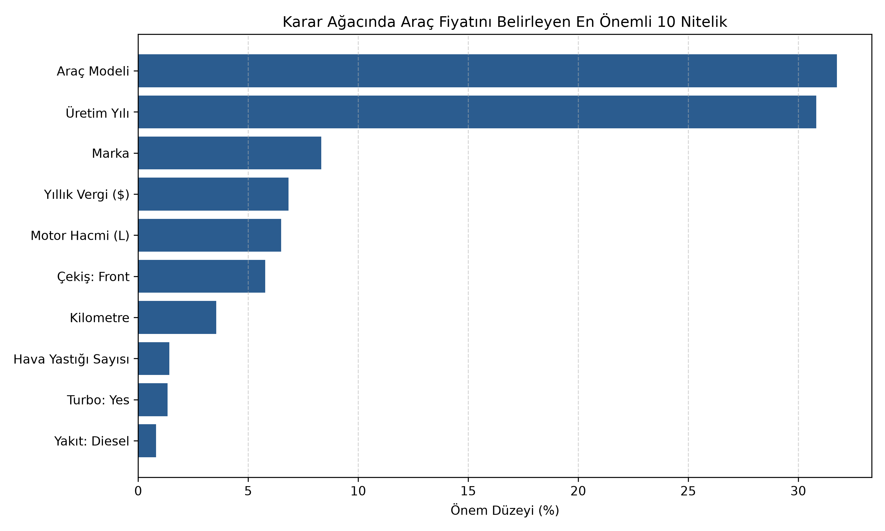
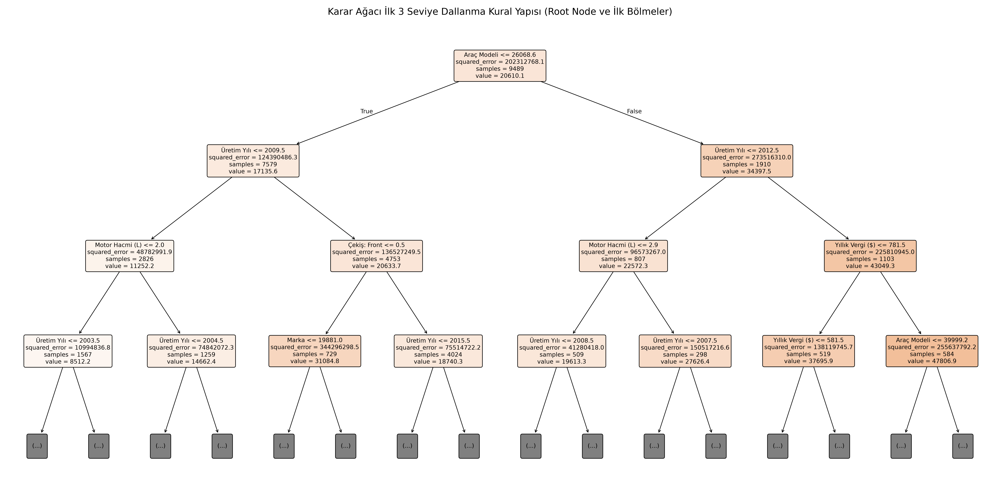

# 🚗 Karar Ağacı Regresyonu ile 2. El Araç Fiyat Tahmini

Bu proje, Makine Öğrenmesi kapsamında **Karar Ağacı Regresyonu (`DecisionTreeRegressor`)** algoritmasını kullanarak ikinci el araçların piyasa değerini tahmin etmek, **aşırı öğrenme (overfitting)** problemini incelemek ve **ağaç budama (pruning)** yöntemlerinin model genelleme başarısına etkisini analiz etmek amacıyla geliştirilmiştir.

Proje aynı zamanda hiperparametrelerin (`max_depth`, `min_samples_split`, `min_samples_leaf` ve Eğitim/Test oranı) model performansına etkisini canlı olarak deneyimleyebileceğiniz interaktif bir **Streamlit** web arayüzü içerir.

---

## 📂 Proje Mimarisi ve Dosya Yapısı

Proje, veri keşfinden canlı arayüze kadar adım adım numaralandırılmış modüler bir boru hattı (pipeline) yapısına sahiptir:

```text
├── 01_tespit.py              # Keşifsel Veri Analizi (EDA): Boyut, veri tipleri, eksik ve benzersiz değer analizi
├── 02_temizlik.py            # Veri Ön İşleme: Kirli metinlerin sayıya dönüştürülmesi ve aykırı değer temizliği
├── 03_egitim.py              # Model Eğitimi: Budanmamış vs. Budanmış Karar Ağacı eğitimi ve performans karşılaştırması
├── 04_gorsellestirme.py      # Açıklanabilirlik: Nitelik önem düzeyleri ve karar ağacı kurallarının görselleştirilmesi
├── app.py                    # İnteraktif Streamlit Arayüzü: Canlı hiperparametre deneyi ve araç fiyat tahmini
├── car_price.csv             # Ham veri seti
├── araba_temiz.csv           # Ön işleme ve temizlik sonrası elde edilen net veri seti
├── car_price_dt_model.pkl    # Eğitilmiş ve optimize edilmiş Pipeline modeli
├── feature_importance.csv    # En önemli 15 niteliğin yüzde (%) bazında ağırlık tablosu
├── feature_importance.png    # Fiyatı belirleyen en önemli 10 niteliğin grafiksel gösterimi
├── tree_structure.png        # Karar ağacının ilk 3 seviye dallanma (Root Node) görseli
└── requirements.txt          # Gerekli Python kütüphaneleri
```

---

## 🛠️ Veri Ön İşleme ve Temizlik Metodolojisi (`02_temizlik.py`)

Ham veri seti (`car_price.csv`) üzerinde model kalitesini artırmak için aşağıdaki mühendislik adımları uygulanmıştır:
1. **Metin Madenciliği & Tip Dönüşümü:**
   * `Engine volume` sütunundaki `"Turbo"` ibaresi ayrıştırılarak yeni bir kategorik **`Turbo` (`Yes`/`No`)** niteliği üretilmiş, motor hacmi `float` tipine çevrilmiştir.
   * `Mileage` sütunundaki `"km"` birimleri temizlenerek tam sayıya (`int`), `Levy` (vergi) sütunundaki `"-"` değerleri `0` olarak dönüştürülmüştür.
2. **Etki Alanı (Domain) Filtreleri:**
   * Motor hacmi `0.8 L – 7.0 L` aralığında, kilometresi `≤ 400.000 km`, üretim yılı `≥ 1995` ve fiyatı `$1.500 – $100.000` aralığında olan gerçekçi gözlemler filtrelenmiştir.
3. **Kardinalite Azaltma & Grup Bazlı Aykırı Değer Temizliği:**
   * Veri setinde 20'den az örneği bulunan nadir modeller `"Other"` çatısı altında toplanmıştır.
   * Aynı `Manufacturer + Category + Prod. year` grubundaki araçların medyan fiyatına göre `%50` altındaki ve `2 katı` üzerindeki aşırı uç fiyatlı ilanlar elenmiştir.

---

## 📊 Budama (Pruning) Öncesi ve Sonrası Performans Analizi (`03_egitim.py`)

Karar ağaçları herhangi bir kısıtlama verilmediğinde eğitim verisini ezberleme (**overfitting**) eğilimindedir. `ColumnTransformer` (`TargetEncoder` + `OneHotEncoder`) boru hattı ile kurulan **Budanmamış Ağaç** ve **Budanmış (Optimize) Ağaç** karşılaştırması aşağıdadır:

| Metrik | Budanmamış Ağaç (Overfit) | Budanmış Ağaç (`max_depth=16`) | Değişim / Yorum |
| :--- | :---: | :---: | :--- |
| **Ağaç Derinliği (`Depth`)** | 36 | **16** | Yarı yarıya daha kompakt yapı |
| **Toplam Yaprak Sayısı (`Leaves`)** | 8.804 | **932** | **%89.4** daha az kural karmaşıklığı |
| **Eğitim $R^2$ Skoru (%)** | %92.33 | %84.61 | Ezberleme (overfit) önlendi |
| **Test $R^2$ Skoru (%)** | %68.29 | **%71.83** | **+3.54 puan** genelleme artışı |
| **Test MAE (Ortalama Mutlak Hata)** | $4,801.44 | **$4,424.60** | Araç başına **~$377** daha düşük hata |
| **Test RMSE (Kök Ortalama Kare Hata)** | $7,974.90 | **$7,516.80** | Büyük hatalarda belirgin düşüş |

---

## 🌳 Model Açıklanabilirliği ve Görseller (`04_gorsellestirme.py`)

### 1. Araç Fiyatını Belirleyen En Önemli 10 Nitelik
Modelin karar verirken varyansı (hatayı) en çok azaltan nitelikleri önem sırasına göre aşağıda görselleştirilmiştir. **Araç Modeli (%31.75)** ve **Üretim Yılı (%30.82)** tek başlarına fiyat değişiminin **%62.5'inden fazlasını** açıklamaktadır:



### 2. Karar Ağacı İlk 3 Seviye Dallanma Yapısı
Budanmış karar ağacının kök düğümden (Root Node) itibaren veriyi hangi eşik değerlerle böldüğünü gösteren ilk 3 seviye kural yapısı:



---

## 💻 Kurulum ve Çalıştırma

### 1. Depoyu İndirin ve Bağımlılıkları Kurun
```bash
git clone https://github.com/KULLANICI_ADINIZ/REPO_ADINIZ.git
cd REPO_ADINIZ
pip install -r requirements.txt
```

### 2. İnteraktif Streamlit Web Arayüzünü Başlatın
Canlı hiperparametre deney paneli, derinlik-başarı eğrisi ve araç fiyat tahmin simülatörünü çalıştırmak için:
```bash
streamlit run app.py
```

### 3. (Opsiyonel) Eğitim ve Görselleştirme Adımlarını Baştan Çalıştırma
Veri analizini, temizliği, model eğitimini ve grafik üretimini terminalden adım adım çalıştırmak isterseniz:
```bash
python 01_tespit.py
python 02_temizlik.py
python 03_egitim.py
python 04_gorsellestirme.py
```
